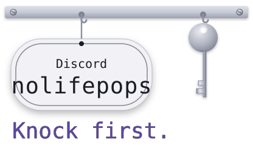
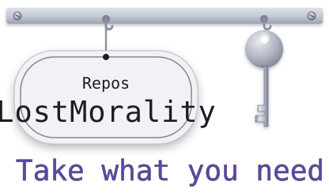
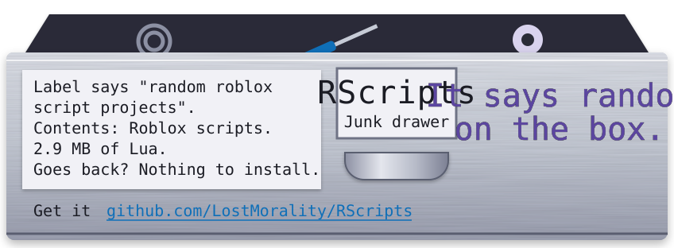
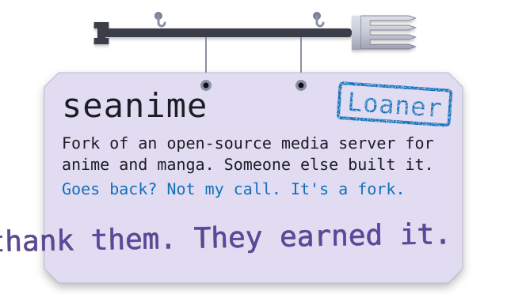
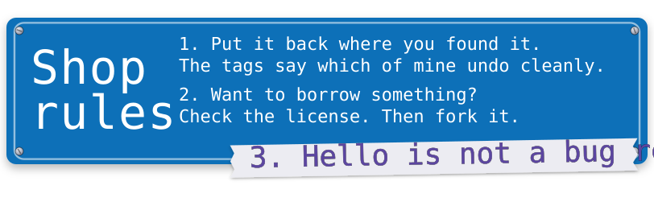
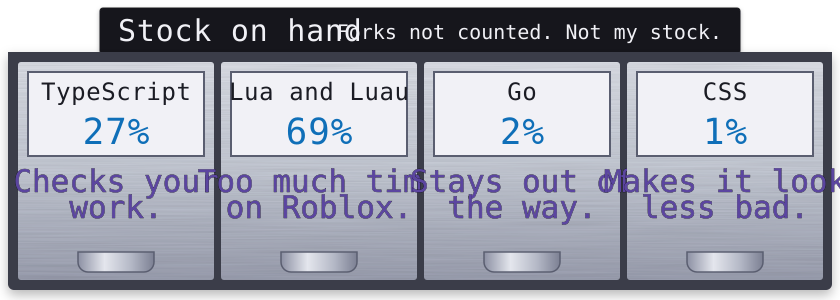
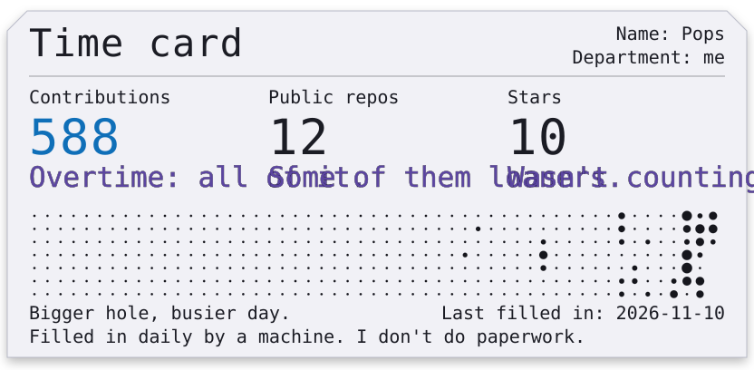

<a href="#"><picture><source media="(prefers-color-scheme: dark)" srcset="assets/hero-dark.svg"></picture></a>

<a href="https://discord.com/users/221807880053981184"><picture><source media="(prefers-color-scheme: dark)" srcset="assets/keys-a-dark.svg"></picture></a><a href="https://github.com/LostMorality?tab=repositories"><picture><source media="(prefers-color-scheme: dark)" srcset="assets/keys-b-dark.svg"></picture></a>

<a href="#"><picture><source media="(prefers-color-scheme: dark)" srcset="assets/label-main-dark.svg"></picture></a>

<a href="https://github.com/LostMorality/cordmuffin"><picture><source media="(prefers-color-scheme: dark)" srcset="assets/cordmuffin-dark.svg"></picture></a>

<a href="https://github.com/LostMorality/RScripts"><picture><source media="(prefers-color-scheme: dark)" srcset="assets/rscripts-dark.svg"></picture></a>

<a href="#"><picture><source media="(prefers-color-scheme: dark)" srcset="assets/label-rest-dark.svg"></picture></a>

<a href="https://github.com/LostMorality/vortex-free-collections"><picture><source media="(prefers-color-scheme: dark)" srcset="assets/vortex-dark.svg"></picture></a>

<a href="https://github.com/LostMorality/seanime"><picture><source media="(prefers-color-scheme: dark)" srcset="assets/seanime-dark.svg"></picture></a>

<a href="#"><picture><source media="(prefers-color-scheme: dark)" srcset="assets/about-dark.svg"></picture></a>

<a href="#"><picture><source media="(prefers-color-scheme: dark)" srcset="assets/rules-dark.svg"></picture></a>

<a href="#"><picture><source media="(prefers-color-scheme: dark)" srcset="assets/stock-dark.svg"></picture></a>

<a href="https://github.com/LostMorality?tab=repositories"><picture><source media="(prefers-color-scheme: dark)" srcset="assets/timecard-dark.svg"></picture></a>

<a href="#"><picture><source media="(prefers-color-scheme: dark)" srcset="assets/closer-dark.svg"></picture></a>

Discord: `nolifepops`

